# DSO202 Assignment 1: Three-Tier Task Tracker on Kubernetes   
### Student name: Pema Dolker  
### student id : 02230294   
### Module : DSO202

For this assignment, I have deployed the given Task Tracker application (nginx frontend, Node.js backend, PostgreSQL database) into a local kind cluster. All the services and deployments are under the namespace `dso202-assignment-01`. Since there is no development involved in this assignment, the focus is on Kubernetes manifest configurations only.

## 1. Repository layout and how to deploy

```text
assignment-1/
├── kind-config.yaml        # cluster config: maps host port 30080 to the node
├── namespace.yaml
├── configmap.yaml
├── secret.yaml
├── quota.yaml              # ResourceQuota and LimitRange
├── rbac.yaml               # optional bonus (Task 8)
├── database/  (pvc.yaml, deployment.yaml, service.yaml)
├── backend/   (deployment.yaml, service.yaml)
├── frontend/  (deployment.yaml, service.yaml)
├── evidence/               # screenshots used in this README
└── README.md
```

```bash
kind create cluster --name dso202-assignment --config kind-config.yaml
kubectl apply -f namespace.yaml -f configmap.yaml -f secret.yaml -f quota.yaml
kubectl apply -f database/
kubectl apply -f backend/
kubectl apply -f frontend/
```

The app is then available at `http://localhost:30080`.

A new kind cluster ` kind create cluster --name dso202-assignment --config kind-config.yaml` was set up for this assignment. The reason why we need to specify the port mapping for the kind cluster is that the "node" is essentially a Docker container, and thus, I included it in my kind-config.yaml. After setting up the kind cluster, I verified that the node is Ready, that the default StorageClass of kind (standard) is present for the database volume, and that port 30080 is mapped to the node.

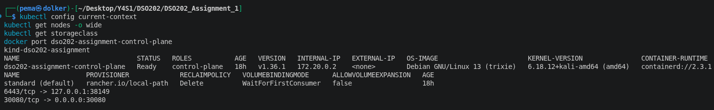

## 2. The images I used (and why)


The instructions mention `sarojsanyasi/dso202-{frontend,backend,db}:1.0`. After `docker buildx imagetools inspect` for the three images, they turned out to be published for `linux/arm64` only. I have an `x86_64` architecture on my computer, which `kind node` calls `amd64`, thus Kubernetes could not run them.

For further steps, I created the three Docker images myself from the source code available with the assignment (`Assignment-1-app-code/`) using Dockerfiles without making any changes and uploaded them to my Docker Hub as `pdolker/dso202-{frontend,backend,db}:1.0`. The difference between using the official images and mine in the manifest files is the `image:` parameter in the three Deployments, and I have indicated those lines with `# TEMP`. When the official images will be republished for `amd64`, I need to change those three lines and apply my manifest file again. Using my own amd64 rebuilds was discussed with the module tutor and approved, since it was the only way to run the application on an amd64 machine.

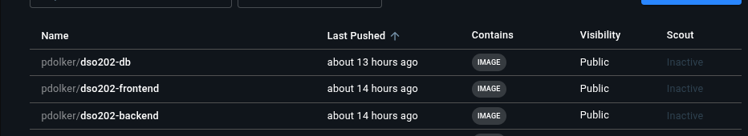


## 3. Task 1: Architecture note

When `kubectl apply` is called, the command goes to the kube-apiserver which checks the request and stores the desired state in etcd. The Deployment controller from the kube-controller-manager detects the requirement of the Deployment for one Pod and requests it via a ReplicaSet. The kube-scheduler picks up the kind node to schedule the new Pod on. On the kind node, the kubelet takes responsibility by instructing containerd to download the image and create a Pod. The kubelet mounts the required volume and also injects the contents of ConfigMap and Secret as environment variables.kube-proxy creates rules for routing traffic from Service to appropriate Pods. CoreDNS provides service discovery functionality for pods allowing them to use services by their names such as `db-svc`.

I used one Deployment and one Service per tier, plus shared configuration objects:

| Tier | Objects | Reasoning |
|---|---|---|
| Database | Deployment (1 replica), PVC, Headless Service `db-svc` | The Deployment recreates the Pod when it dies. The PVC stores the data outside the Pod. The Headless Service provides the database with a DNS name in the namespace but does not have a virtual IP and is not accessible from the outside. |
| Backend | Deployment, ClusterIP Service `backend-svc` | The backend does not store any data and can thus be recreated anytime. The ClusterIP Service type implies that the service is available inside the cluster only. |
| Frontend | Deployment, NodePort Service `frontend-svc` | It is the only object which needs to be accessed from the outside, hence the only one using a NodePort (30080). |
| Shared | Namespace, ConfigMap `app-config`, Secret `db-credentials`, ResourceQuota, LimitRange | Isolation from other workload and separation of the configuration from the container images, and limiting resource consumption. |


## 4. Task 2: ConfigMap and Secret

The non-sensitive variables are stored in the ConfigMap `app-config`: `DB_HOST`, `DB_PORT`, `DB_NAME`, `APP_PORT`, `CORS_ORIGIN`, `POSTGRES_DB` and `BACKEND_URL`. The credentials are stored in the Secret `db-credentials`: `DB_USER`, `DB_PASSWORD`, `POSTGRES_USER` and `POSTGRES_PASSWORD`.

The backend reads `DB_*` and the official PostgreSQL image reads `POSTGRES_*`. These are just different names for the same information, thus I have provided both, with identical values (`DB_NAME` and `POSTGRES_DB` contain the database name and so on). Without one of these two sets, one of the two tiers would be left unconfigured. The value `DB_HOST` is set to `db-svc` which is the name of the database service.

I have listed each variable individually in the Deployments (`configMapKeyRef`/`secretKeyRef`) rather than using `envFrom` to load a whole ConfigMap because in this way each tier gets exactly what it needs and it is clear from the YAML files that the database uses `POSTGRES_*` and the backend `DB_*`.

**Secret caveat.** Kubernetes Secrets are encoded only in base64, and they are not by default encrypted when at rest. Everyone who can access the Secret will be able to decode it using only one command, which can be seen below from the screenshot of the process for the username. I encoded the data into `secret.yaml` in base64 (`data:`) form so that no passwords are saved in plaintext in the committed file. It does not make Secrets secure, but that is beyond the scope of this task.

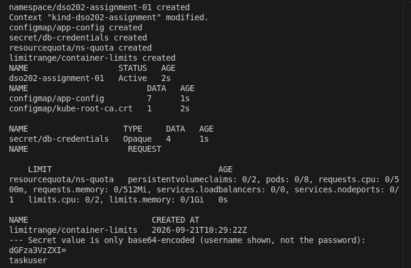

## 5. Tasks 3 to 5: The three tiers


| Resource      | Name        | Notes                                   | `tier` label |
| ------------- | ----------- | --------------------------------------- | ----------- |
| PVC           | `db-pvc`    | 1Gi, ReadWriteOnce, default StorageClass `standard`  | database  |
| Deployment    | `db`        | 1 replica, mounts the PVC at `/var/lib/postgresql/data`, uses `POSTGRES_*` | database  |
| Service       | `db-svc`    | headless (`clusterIP: None`), port 5432 | database  |
| Deployment    | `backend`   | 1 replica, uses `DB_*`                | backend  |
| Service       | `backend-svc` | ClusterIP, port 8080              | backend  |
| Deployment    | `frontend`  | 1 replica, uses `BACKEND_URL`       | frontend  |
| Service       | `frontend-svc` | NodePort 30080 to port 8080     | frontend  |

Every Pod, Deployment and Service has a `tier` label (as well as `app: task-tracker`). The Deployment and Service selectors use both labels, so each Service only picks up the Pods of its own tier.

**Database.** The PVC is attached to PostgreSQL's data directory, so that the data will be stored on the volume, not in the filesystem of the container itself. I configured the deployment to use the `Recreate` strategy. With the default `RollingUpdate` strategy, Kubernetes will launch a new Pod with the database before shutting down the old one, and two PostgreSQL databases cannot run using one and the same data directory. `Recreate` will stop the old Pod first.
The default `StorageClass` from kind will create the volume only after a Pod requesting it is scheduled, so the PVC can be in `Pending` state for a while.

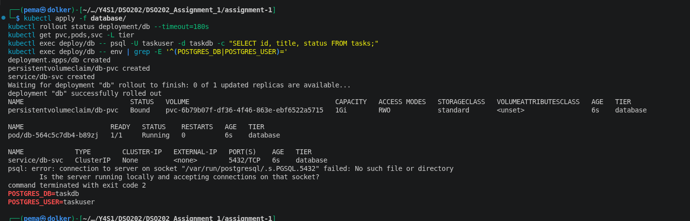

**Backend.** `DB_HOST` refers to `db-svc`. In case the backend does not start because the database is not started yet, it logs that it will be retried, so I did not require any probes or ordering techniques as it is shown in the start log. The Service can be accessed only via ClusterIP.


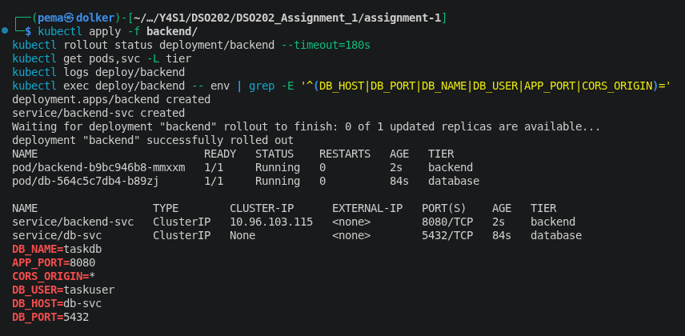

**Frontend.** The image sets `BACKEND_URL` in the `config.js` file on container startup. As it can be seen from the picture below, the substitution is performed successfully, so the change of the URL will require only Pod restarting. 

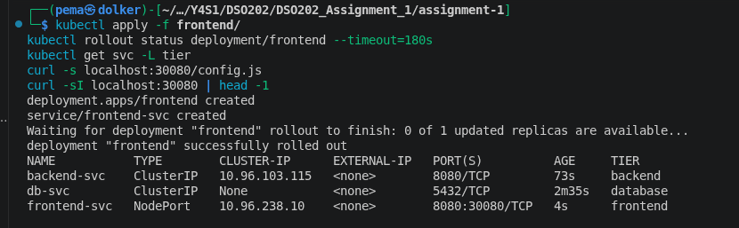

All the resources together, with the labels:

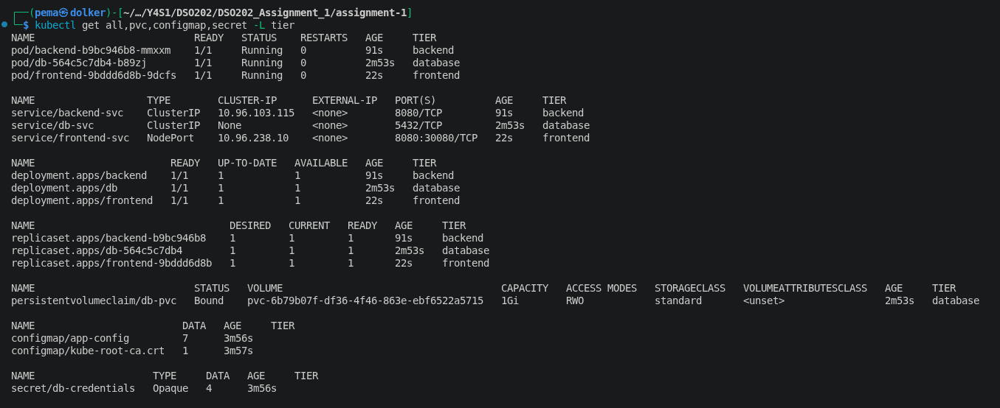

**Some information about the browser and the backend.** The frontend is a static website, so its JS code will be executed on the client side, which means `BACKEND_URL` is accessed on the client side. `backend-svc` is an internal ClusterIP, which means that a browser on my machine would not be able to resolve it, so the frontend is up but cannot access the backend. The brief allows the use of `curl` via port-forwarded backend to provide the CRUD evidence, and this one is my main evidence. As for the browser screenshots in part 7a, I made it work temporarily by adding `127.0.0.1 backend-svc` in `/etc/hosts` and executing `kubectl port-forward svc/backend-svc 8080:8080`. Nothing was done to the manifests, and the hosts file entry was deleted afterwards. `BACKEND_URL` in ConfigMap is kept the same.

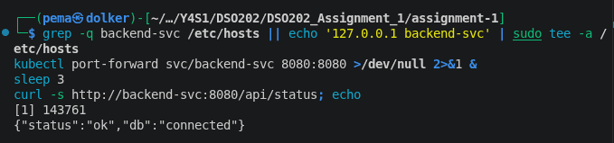

## 6. Task 6: ResourceQuota and LimitRange

Every container gets requests and limits set. If a namespace has CPU/Memory quotas then all Pods have to specify them (or use the LimitRange default). So, it is better to set them explicitly. The values are low due to the small size of the application:


| | Requests (CPU / memory) | Limits (CPU / memory) |
|---|---|---|
| db | 100m / 128Mi | 500m / 256Mi |
| backend | 50m / 64Mi | 250m / 256Mi |
| frontend | 25m / 32Mi | 100m / 64Mi |
| **Total** | **175m / 224Mi** | **850m / 576Mi** |
| With one extra backend Pod during a rolling update | 225m / 288Mi | 1100m / 832Mi |

I sized the quota from those totals and did not pick round numbers at random:

- **requests 500m CPU / 512Mi:** enough to cover the rolling update peak (225m / 288Mi) + an extra debug Pod.
- **limits 2 CPU / 1Gi:** enough to cover the peak of 1100m / 832Mi.
- **pods 8:** three are running, an extra pod in case of a rolling update, one test pod + two extras.
- **persistentvolumeclaims 2:** one needed, one is extra.
- **services.nodeports 1 and services.loadbalancers 0:** just the frontend is allowed to have NodePort and LoadBalancer (as per the brief).

A LimitRange sets a default for those containers which request/limit nothing – 50m / 64Mi request and 250m / 256Mi limit. Minimum limits are set to 10m / 16Mi while the maximum is 500m / 512Mi. Maximum limits match the largest Pod (the database) with a margin and prevent any single Pod taking a large chunk of the quota. All Deployments are within the specified limits and "Used" column in the table below is in agreement with my limits.

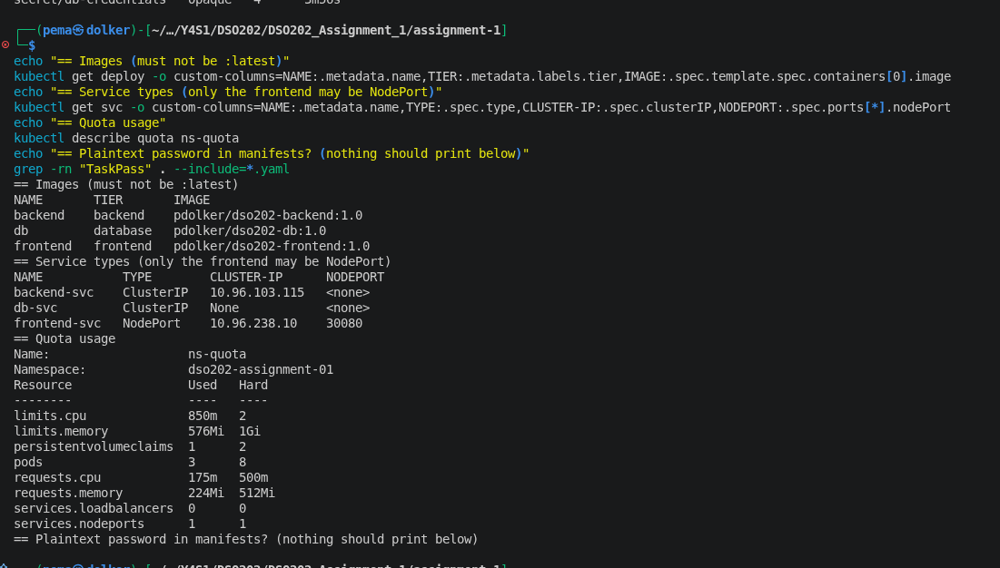

The same screenshot shows that the image tags are `1.0` and not `latest`, that only the frontend is a NodePort, and that the search for a plaintext password in the manifests finds nothing.

## 7. Task 7: Verification

### 7a. Full CRUD cycle

I used `curl` through a port-forwarded backend: list the tasks, create one (POST), read it, update its status to `in_progress` (PUT), delete it (`HTTP 204`) and then read it again to get a `404`.

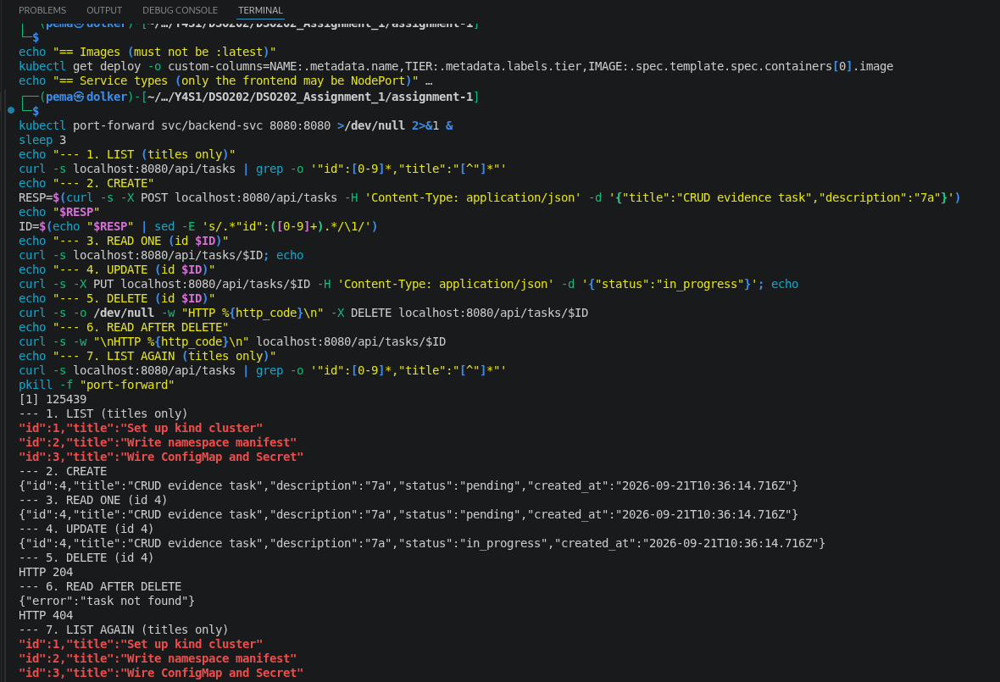

I also did the same things in the web page using the temporary hosts entry explained in section 5:

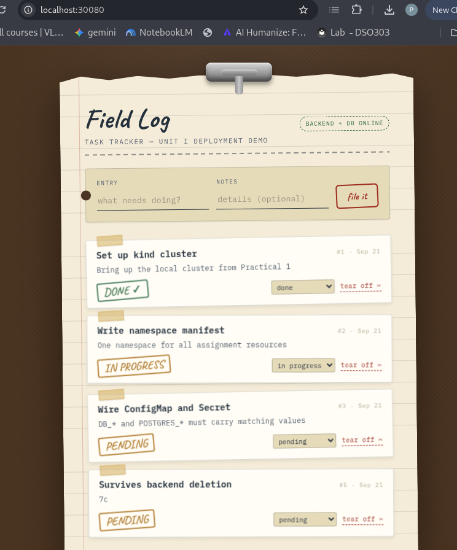

Playing around Frontend - adding, updating and deleting tasks 


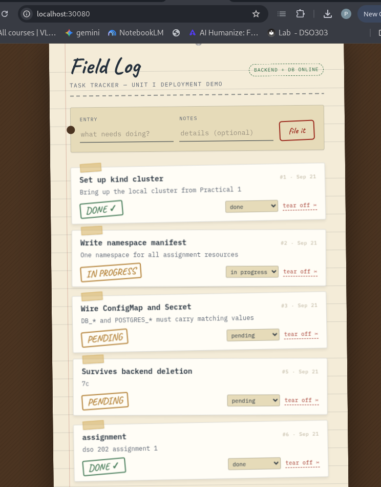


### 7b. Service DNS from inside the frontend Pod

I did `curl http://backend-svc:8080/api/status` from the frontend Pod and received the output {"status":"ok","db":"connected"}. No port forward was done, therefore the Pod is getting the Service name resolved using CoreDNS. I also did `nslookup`: backend-svc gets resolved to the cluster IP whereas db-svc, being a headless Service, gets resolved directly to the database Pod IP.

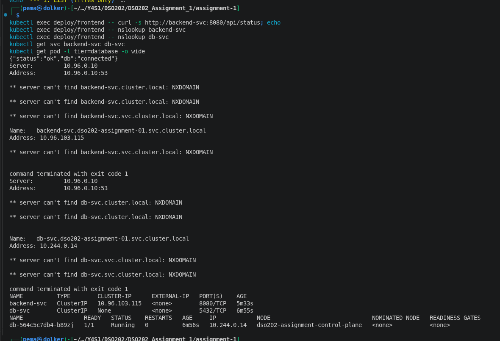

### 7c. Self-healing and data persistence

First I created a task and listed the Deployment, ReplicaSet and Pod for the backend:

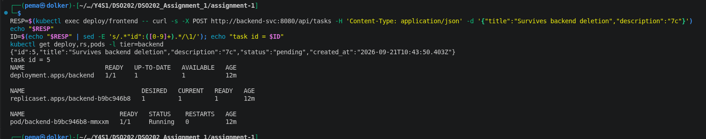

Then, I deleted the backend Pod using the command `kubectl delete pod -l tier=backend` and observed using `kubectl get pods --watch`. The existing Pod gets into state `Terminating` and a new Pod is created with a different name and enters state `Running` without my intervention:

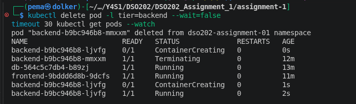

The task I created before the deletion is still there:

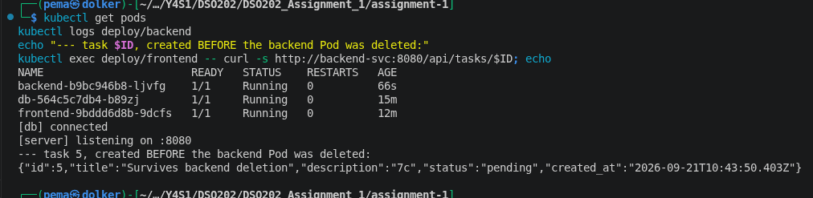

The ReplicaSet was responsible for recreating the pod, in that it is configured to maintain one backend pod, but sees none and hence creates a new pod. This task succeeded because it resides on the Persistent Volume via PostgreSQL and not within the backend pod itself. 

Another test involved deleting the database Pod too. The PVC remained in the `Bound` state, a new database Pod was created that used the same volume, and the same task was also generated again.


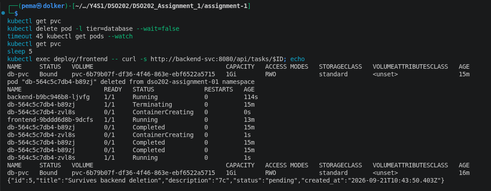

### 7d. Declarative vs imperative

The ConfigMap was defined declaratively using `kubectl apply -f configmap.yaml`, and another one was defined imperatively using `kubectl create configmap app-config-imp --from-literal=...`. Then the second command was executed again:

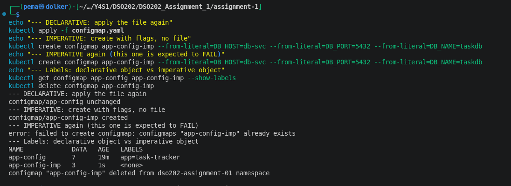

What happened: When the same file is applied again, the message "unchanged" appears; when the `create` command is repeated, there is an error "AlreadyExists". The declarative object has the label `app=task-tracker`, but the imperative one does not have any labels since only three keys were provided as arguments.

| | Declarative (`apply -f`) | Imperative (`create ...`) |
|---|---|---|
| Running it again | Safe, says `unchanged` or `configured` | Fails with `AlreadyExists` |
| Record of what I wanted | A YAML file I can keep in git and review | Only in the cluster and my shell history |
| Completeness | Labels, namespace and all keys in one place | Only what I remembered to type as flags |
| Speed | Needs a file first | Quickest for a quick test |

In this case, declarative is definitely better since everything should be reproducible and provided as files. Imperative commands can be used to quickly test something and debug.

## 8. Task 8 (bonus): Namespace RBAC


The `rbac.yaml` file defines ServiceAccount `readonly-sa`, Role `namespace-reader` and RoleBinding. It enables `get`, `list`, and `watch` operations for Pods, Pod logs, Services, ConfigMaps, PVCs, Deployments, and ReplicaSets. I intentionally did not include Secret in this list. As it is a Role and not a ClusterRole, it only works in `dso202-assignment-01` namespace. Checked it with `kubectl auth can-i --as=system:serviceaccount:dso202-assignment-01:readonly-sa`. It says that reading is permitted in the namespace, but not deleting Pods, reading Secrets and reading Pods in `kube-system`.

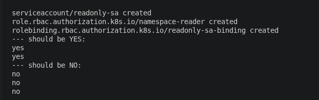

## 9. Problems I ran into and what I changed

- **The published images did not work on my computer.** Discussed in section 2. I re-created them using the given source code and modified only the `image:` lines.
- **`CreateContainerConfigError` in the database Pod.** I created the database earlier than `app-config` and `db-credentials`, and, thus, it did not find the values to read. After creating these resources and recreating the Deployment, everything started working and now I create the ConfigMap and Secret first.
- **`kubectl port-forward` failed with "address already in use".** There was an old port-forward using port 8080. I found it by using `ss -ltnp` command and killed it; now I close each tunnel immediately after I use it.
- **The backend reported `EAI_AGAIN` and "retrying" errors on startup.** The name of the database could not be resolved because the database Pod was still starting. It is the retry mechanism that is expected according to the brief: the backend keeps trying until it connects.
- **The web application cannot communicate with the backend.** Discussed in section 5.

- **One backend Pod was restarted once, several seconds after it started.** The container ended with code 133 (SIGTRAP), and the previous log of the same container had shown an internal error from Node.js' V8 engine. I verified that it was not a case of exceeded memory limits (they have exit code 137 and message `OOMKilled`), and it was not a misconfiguration. Kubernetes automatically retried the run and the data remained unaffected. I could not find the cause of the issue, but I mention it as another example of Kubernetes retries of failed containers.

## 10. Limitations

- One replica of each tier implies lack of high availability. Pods are automatically restarted upon death, but there is a small time gap.
- The secrets are just base64-encoded (see section 4); `CORS_ORIGIN` equals `*` in classroom context; in real deployments, they should be restricted to known origins.
- I have omitted readiness probes because this brief keeps the assignment in the scope of Unit I, and the retry loop of the backend itself solves the start-up order issue.
- The images I use are x86_64 only (section 2).