# DSO202 Assignment 3: Packaging the Task Tracker with Kustomize and Helm

**Student:** Pema Dolker  
**Student ID:** 02230294  
**Module:** DSO202: Scaling, Orchestration, Monitoring & Observability

## Table of Contents

1. Introduction
2. Repository layout
3. Environment and setup
4. Part A: Kustomize
5. Part B: Helm
6. Kustomize and Helm compared
7. Problems I ran into
8. Limitations
9. How to reproduce

## 1. Introduction

The instruction for this assignment was to implement Assignment 1 again using package and configuration management tools, namely Kustomize and Helm. In Assignment 1 the Task Tracker (nginx frontend, Node.js backend, PostgreSQL database) was deployed with plain YAML files applied one by one with `kubectl apply -f`. That works for one environment, but every new environment would need a full copy of the files, and kubectl has no idea that the objects belong together as one application.

I kept the application exactly as it was in A1: the same images, the same ConfigMap and Secret keys, a database Deployment with a PVC and a headless Service, a ClusterIP backend, a NodePort frontend, and the same ResourceQuota and LimitRange. The A2 changes (StatefulSet, Ingress, RBAC) are not used here, so that the difference between A1 and A3 is only in how the application is packaged and configured, not in what it is.

The same application is deployed in two ways, side by side:

- **Kustomize**: one base that holds the A1 objects, and two overlays (`dev` and `prod`) that describe only what is different.
- **Helm**: one chart (`tasktracker`) with templates, a documented values file and a values schema, plus one values file per environment.

Each tool deploys a dev and a prod environment, which gives four namespaces in total. This made it possible to run both tools against the same cluster at the same time and compare them on the same application.

## 2. Repository layout

```text
assignment-3/
├── kustomize/
│   ├── .gitignore                       # keeps overlays/*/db.env out of git
│   ├── base/
│   │   ├── kustomization.yaml           # resources, labels, images, configMapGenerator
│   │   ├── quota.yaml                   # ResourceQuota + LimitRange (A1 values)
│   │   ├── database/  (pvc.yaml, deployment.yaml, service.yaml)
│   │   ├── backend/   (deployment.yaml, service.yaml)
│   │   └── frontend/  (deployment.yaml, service.yaml)
│   └── overlays/
│       ├── dev/
│       │   ├── kustomization.yaml
│       │   ├── namespace.yaml
│       │   ├── patch-frontend-nodeport.yaml        # strategic merge patch
│       │   └── db.env.example
│       └── prod/
│           ├── kustomization.yaml
│           ├── namespace.yaml
│           ├── patch-backend-resources.yaml        # strategic merge patch
│           ├── patch-quota.yaml                    # strategic merge patch
│           ├── patch-frontend-nodeport.json6902.yaml  # JSON 6902 patch
│           └── db.env.example
├── helm/
│   ├── .gitignore                       # keeps environments/secrets.yaml and *.tgz out of git
│   ├── environments/
│   │   ├── dev.yaml
│   │   ├── prod.yaml
│   │   └── secrets.example.yaml
│   └── tasktracker/
│       ├── Chart.yaml
│       ├── values.yaml
│       ├── values.schema.json
│       ├── .helmignore
│       └── templates/
│           ├── _helpers.tpl
│           ├── configmap.yaml, secret.yaml
│           ├── db-pvc.yaml, db-deployment.yaml, db-service.yaml
│           ├── backend-deployment.yaml, backend-service.yaml
│           ├── frontend-deployment.yaml, frontend-service.yaml
│           ├── quota.yaml               # ResourceQuota + LimitRange
│           ├── NOTES.txt
│           └── tests/ (test-backend.yaml, test-frontend.yaml)
├── evidence/                            # screenshots used in this README
└── README.md
```

## 3. Environment and setup

The cluster is the same single-node kind cluster used in A2 (`dso202-assignment`), with host port 30080 mapped to the node. The A2 application was left running in its own namespace and was not touched. The images are my amd64 rebuilds `pdolker/dso202-{frontend,backend,db}:1.0`, for the reason explained in A1 (the tutor's images are published for arm64 only, and using the rebuilds was approved by the tutor).

| Tool | Environment | Namespace | Frontend NodePort |
|---|---|---|---|
| Kustomize | dev | `a3-kustomize-dev` | 30080 |
| Kustomize | prod | `a3-kustomize-prod` | 30081 |
| Helm | dev | `a3-helm-dev` | 30082 |
| Helm | prod | `a3-helm-prod` | 30083 |

NodePorts are unique across the whole cluster, not per namespace, so each environment needs its own number. Only 30080 is mapped to `localhost` in the kind config. The other three are reachable from my laptop through the IP address of the kind node container (`172.20.0.2`), because on Linux the host can reach containers on the Docker network directly, and a NodePort is opened on every node.

**Credentials.** A1 had a rule that no credential may be committed in plain text, and I kept that rule for both tools:

- For Kustomize, the Secret is produced by a `secretGenerator` that reads `overlays/<env>/db.env`. That file is listed in `.gitignore`, and only `db.env.example` (with `change-me` placeholders) is committed.
- For Helm, the credentials are passed in a separate values file, `environments/secrets.yaml`, which is also gitignored. Only `secrets.example.yaml` is committed.

Anyone rebuilding the project copies the example files and fills in their own values (section 9).

## 4. Part A: Kustomize

### 4.1 The idea

Kustomize keeps the shared Kubernetes objects once (the base) and describes each environment as a small set of differences (an overlay). It does not use templates. The base files are ordinary, valid Kubernetes YAML, and Kustomize builds the final YAML by combining the base with the overlay's changes. In short: the base stores what is shared, the overlay stores what is different, and the rendered output is what actually goes to the cluster.

Kustomize is built into kubectl, so no extra tool was needed. `kubectl kustomize <dir>` renders an overlay, and `kubectl apply -k <dir>` renders and applies it in one step. The `-k` flag points to a directory containing a `kustomization.yaml`, not to a single YAML file.

### 4.2 The base

The base contains the seven A1 objects (a PVC, three Deployments and three Services) plus the quota file with three changes from the A1 files:

1. **No namespace.** The namespace is chosen by each overlay, so it does not belong in the base.
2. **No `nodePort` number** on the frontend Service. It is still `type: NodePort`, but the port number is set by each overlay, since two environments cannot share one NodePort.
3. **The ConfigMap is generated** instead of being a static file. `configMapGenerator` creates `app-config` from the same seven keys as A1 (`DB_HOST`, `DB_PORT`, `DB_NAME`, `APP_PORT`, `CORS_ORIGIN`, `POSTGRES_DB`, `BACKEND_URL`).

The base `kustomization.yaml` also uses two transformers that change many objects at once:

- **`labels`** adds `app.kubernetes.io/part-of: task-tracker` and `app.kubernetes.io/managed-by: kustomize` to every object and every Pod template. I set `includeSelectors: false`, so the selectors stay exactly as in A1 (`app` and `tier`). Deployment selectors cannot be changed after creation, and Service selectors decide where traffic goes, so adding labels to selectors without a good reason could break the routing or block later updates.
- **`images`** sets the tag of all three images in one place. To move to a new image version, only these three lines would change.

The Deployments still refer to the ConfigMap as `app-config` and to the Secret as `db-credentials`, exactly as in A1. Kustomize rewrites these references to the generated names automatically, as shown in section 4.5.

### 4.3 The overlays

Both overlays import the base with `resources: - ../../base`, add their own Namespace object, set `namespace:` so that every object is placed in it, and add an `app.kubernetes.io/environment` label. The Secret is generated in each overlay from that overlay's `db.env`, so each environment can have different credentials.

**Dev** is the base as it is: one replica of each tier and the A1 quota. Its only patch is a strategic merge patch that sets the frontend NodePort to 30080:

```yaml
apiVersion: v1
kind: Service
metadata:
  name: frontend-svc
spec:
  ports:
    - port: 8080
      nodePort: 30080
```

**Prod** changes several things, and each one uses the simplest Kustomize field that does the job:

| Change | Kustomize field | Why this field |
|---|---|---|
| backend and frontend to 2 replicas | `replicas:` | Built-in transformer, no patch file needed |
| backend requests 100m/128Mi, limits 500m/384Mi | strategic merge patch | Changing one named container's resources is easiest to read as a Kubernetes-shaped fragment |
| bigger ResourceQuota | strategic merge patch | Only the five changed `hard` keys are written; the rest come from the base |
| NodePort 30081 | JSON 6902 patch | One operation at one exact path |
| database name `taskdb_prod` | `configMapGenerator` with `behavior: merge` | Keeps every base key and overrides only `DB_NAME` and `POSTGRES_DB` |

The JSON 6902 patch is an `add` and not a `replace`, because the base Service has no `nodePort` field to replace:

```yaml
- op: add
  path: /spec/ports/0/nodePort
  value: 30081
```

I used one strategic merge patch and one JSON 6902 patch on purpose, to compare the two styles on the same kind of change. The strategic merge patch is easier to read, because it looks like the object itself. The JSON 6902 patch is shorter and more precise, but you have to know the exact path in the object, including the list index `0`.

**Prod quota.** The A1 quota was sized for one replica of each tier. Prod runs one database, two backends and two frontends, and during a rolling update one extra backend Pod exists for a short time:

| | CPU | Memory |
|---|---|---|
| Requests, normal | 100 + 2×100 + 2×25 = 350m | 128 + 2×128 + 2×32 = 448Mi |
| Requests, during backend rollout | 450m | 576Mi |
| Limits, normal | 500 + 2×500 + 2×100 = 1700m | 256 + 2×384 + 2×64 = 1152Mi |
| Limits, during backend rollout | 2200m | 1536Mi |

The A1 values (500m and 512Mi requests, 2 CPU and 1Gi limits) would block the prod rollout, so the patch raises them to 1 CPU and 1Gi for requests, 3 CPU and 2Gi for limits, and 10 Pods. Each value covers the rollout peak with a small margin.

**Why I did not use `namePrefix`.** Kustomize can add a prefix such as `dev-` to every object name, which is a common way to separate environments. It rewrites references between objects (for example a Deployment's `configMapKeyRef`), but it does not change text inside ConfigMap values. `DB_HOST=db-svc` and `BACKEND_URL=http://backend-svc:8080` are plain strings, so with a prefix the Services would become `dev-db-svc` and `dev-backend-svc` while the ConfigMap would still point to the old names, and the backend would not find the database. Separate namespaces avoid this problem, because the same short names can exist in each namespace.

### 4.4 Render, diff, apply, verify

I followed the order recommended in the notes: render first, then diff, then apply, then verify.

**Render.** `kubectl kustomize` prints the final YAML without contacting the cluster. The screenshot filters the prod render to the fields that matter: the generated ConfigMap and Secret names with hash suffixes, the namespace on every object, 2 replicas, NodePort 30081 and `DB_NAME: taskdb_prod`.

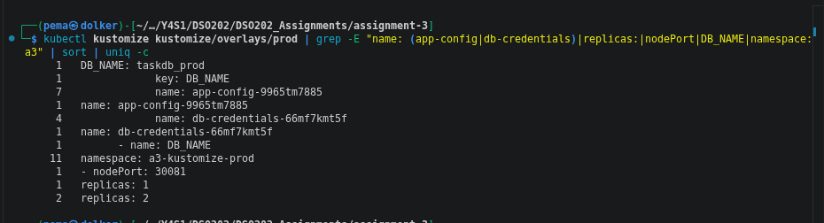

**Diff.** `kubectl diff -k` asks the API server what would change if the overlay were applied. On the first attempt it failed with `namespaces "a3-kustomize-dev" not found`. The diff is a dry run, so it does not create the namespace, and every namespaced object inside it fails. After creating the two Namespace objects first, the diff worked and showed every object as new:

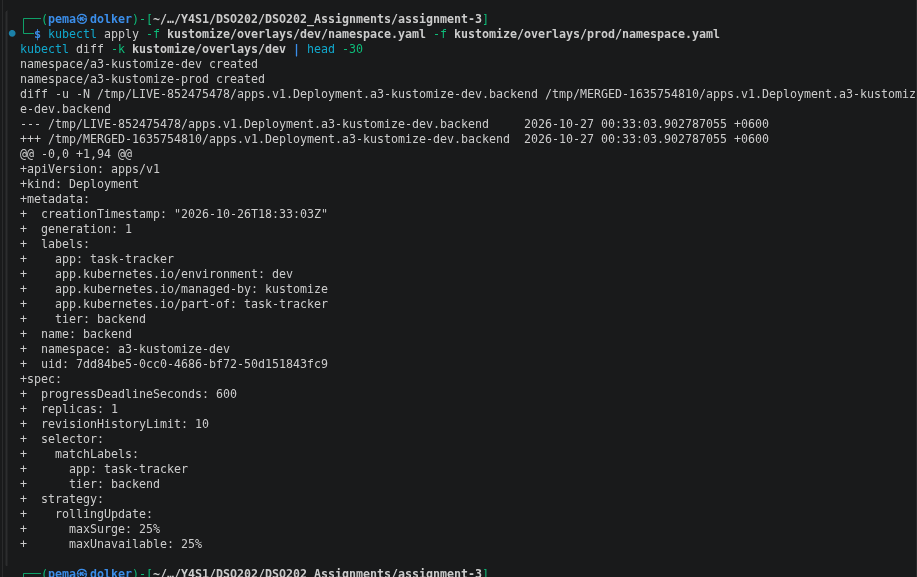

**Apply.** Both overlays were applied with `kubectl apply -k`. Each namespace received its own ConfigMap and Secret with a hash suffix, its own PVC and its own Services and Deployments:

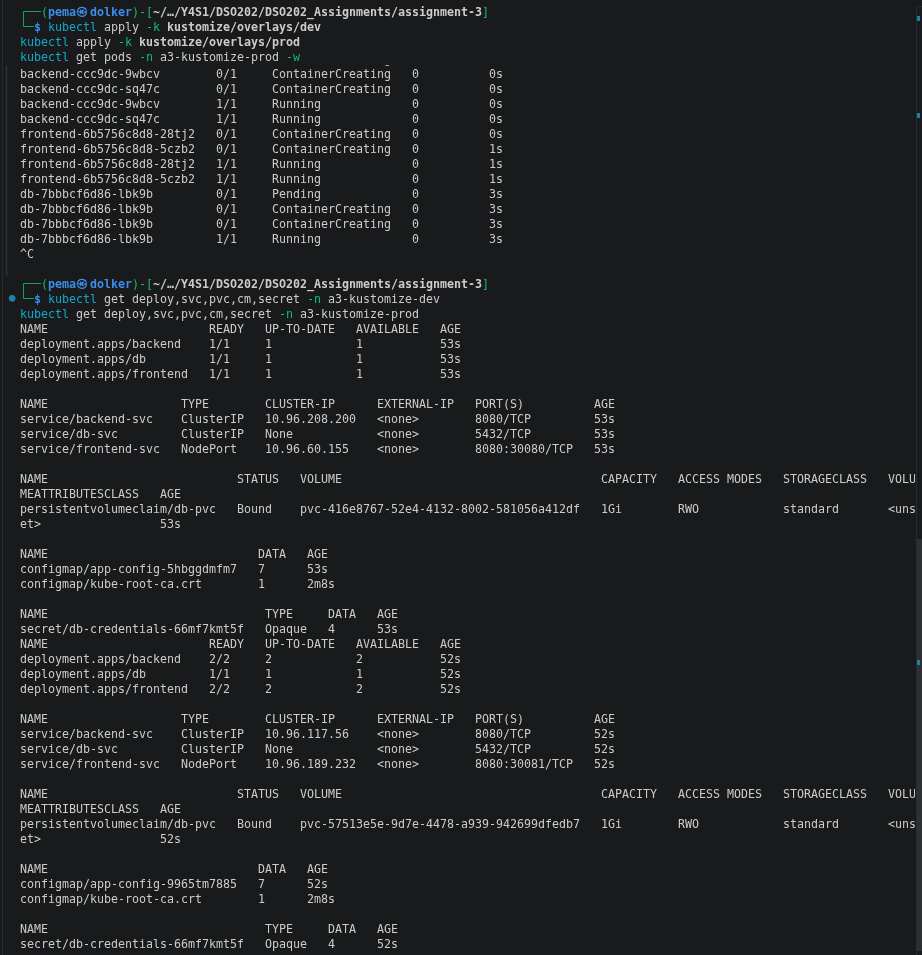

**Verify.** Four checks were made:

- From inside the dev frontend Pod, `curl http://backend-svc:8080/api/status` returned `{"status":"ok","db":"connected"}`. This confirms that DNS, the generated ConfigMap, the generated Secret and the database all work together in dev.
- From inside the prod frontend Pod, `/api/tasks` returned the three seed tasks. Running `psql \l` in the prod database Pod lists `taskdb_prod`, which shows that the generator merge took effect and that the image's seed script ran inside the new database.
- `curl http://localhost:30080` returned the dev frontend's HTML.
- `curl http://172.20.0.2:30081` returned the prod frontend's HTML through the node IP.

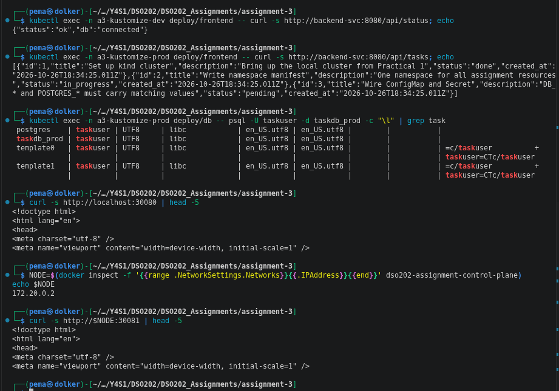

### 4.5 A generated ConfigMap change causes a rollout

The hash suffix on a generated ConfigMap is a hash of its contents. To show what that means in practice, I temporarily changed `CORS_ORIGIN` in the base from `*` to `http://localhost:30080` and applied the dev overlay again.

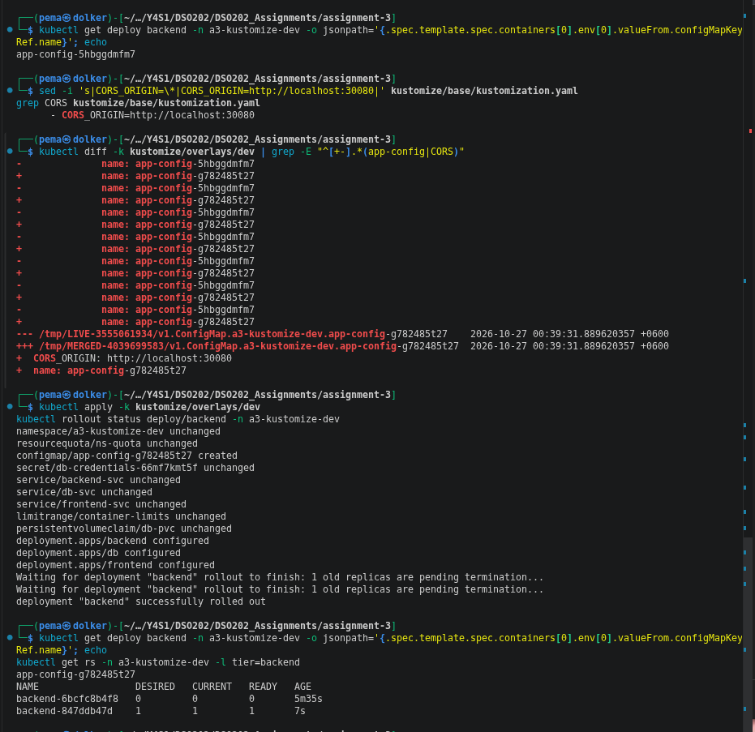

The chain of events was:

1. The ConfigMap content changed, so its name changed from `app-config-5hbggdmfm7` to `app-config-g782485t27`.
2. `kubectl diff` showed Kustomize rewriting every reference to the ConfigMap in the Deployments.
3. Since the reference is inside the Pod template, the Pod template changed, and the Deployment rolled out new Pods. `kubectl get rs` shows the old backend ReplicaSet at 0 Pods and a new one at 1.

With a plain ConfigMap (as in A1), editing a value does not restart anything. The Pods keep the old environment variables until someone restarts them by hand. The hash makes the restart happen automatically and makes the change visible in the object name.

Two more things can be seen in this test:

- **All three Deployments rolled out**, not only the backend, because all three refer to the same `app-config`, even though only the backend reads `CORS_ORIGIN`. This is the cost of one shared ConfigMap. Splitting it per tier would avoid unnecessary restarts, but I kept one ConfigMap to match the A1 design. The database restart was safe because the data is on the PVC, and the Deployment uses `Recreate`.
- **Undoing the change brought back the exact same name**, `app-config-5hbggdmfm7`. The same content always gives the same hash, so the build is deterministic: anyone building the same commit gets the same output.

### 4.6 `kubectl delete -k` removes the data too

To compare with Helm later (section 5.12), I created a task in dev, deleted the whole overlay with `kubectl delete -k` and applied it again.

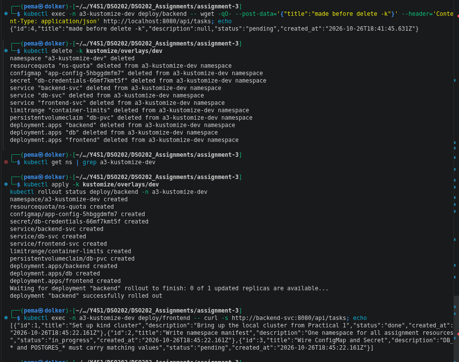

Task 4, "made before delete -k", was created successfully. `delete -k` removed every object in the overlay, including the Namespace and the PVC. After applying again, only the three seed tasks were present, with new `created_at` times, because PostgreSQL started on a new empty volume and ran its seed script again. Kustomize has no way to mark an object as "keep this when deleting", so deleting an overlay that contains a PVC also deletes the data.

## 5. Part B: Helm

### 5.1 The idea

Helm is a package manager for Kubernetes. A chart is a versioned package of templates and default values. Installing a chart with a set of values creates a release, which Helm records as numbered revisions. That record is what makes it possible to upgrade, roll back and uninstall the whole application as one unit, which plain kubectl and Kustomize cannot do.

Unlike Kustomize, Helm templates are not valid YAML until they are rendered. They contain Go template actions such as `{{ .Values.backend.replicaCount }}`, which are replaced with values at render time.

### 5.2 Chart structure

| File | Purpose |
|---|---|
| `Chart.yaml` | Name `tasktracker`, chart `version: 0.1.0`, `appVersion: "1.0"`, `kubeVersion: ">=1.30.0-0"` |
| `values.yaml` | Every setting with a default and a comment. This is the chart's interface for whoever installs it |
| `values.schema.json` | Rules that every set of values must follow (section 5.6) |
| `templates/_helpers.tpl` | Named templates for names and labels, used by every other template |
| `templates/*.yaml` | One template per object: ConfigMap, Secret, PVC, three Deployments, three Services, quota and LimitRange |
| `templates/NOTES.txt` | Instructions printed after install and upgrade |
| `templates/tests/` | Two test Pods run by `helm test` (section 5.8) |

`version` and `appVersion` mean different things. `version` is the version of the chart itself and must increase whenever any chart file changes. `appVersion` is the version of the application it deploys. The image tags default to `appVersion`, so moving to new images only needs a change in `Chart.yaml`. `appVersion` is in quotes because YAML would otherwise read `1.0` as a number.

### 5.3 Helpers and naming

Object names are built from the release name instead of being fixed. The release `tasktracker-dev` produces `tasktracker-dev-db`, `tasktracker-dev-backend`, `tasktracker-dev-frontend`, `tasktracker-dev-config` and so on. Because the release name already contains the chart name, the `tasktracker.fullname` helper uses it alone, so names do not become `tasktracker-dev-tasktracker-db`. Every name is cut to 63 characters, the limit for Kubernetes labels and DNS names.

The important result is that `DB_HOST` and `BACKEND_URL` in the ConfigMap are generated from the same helpers as the Service names:

```yaml
DB_HOST: {{ include "tasktracker.dbName" . | quote }}
BACKEND_URL: {{ printf "http://%s:%v" (include "tasktracker.backendName" .) .Values.backend.port | quote }}
```

If the release is renamed, the Services and the ConfigMap values change together. This is exactly the problem that stopped me from using `namePrefix` in Kustomize (section 4.3). In Helm it does not exist, because the values are computed rather than typed.

There are two label sets:

- **Selector labels** (`app.kubernetes.io/name`, `app.kubernetes.io/instance`, plus `tier` per tier) are small and never change. `Deployment.spec.selector` cannot be changed after the first install, so a label that changes between versions must never be in a selector.
- **Full labels** add `helm.sh/chart`, `app.kubernetes.io/version`, `app.kubernetes.io/managed-by`, `app.kubernetes.io/part-of`, `app.kubernetes.io/environment` and the A1 label `app: task-tracker`. Every object also has the A1 `tier` label.

### 5.4 Template techniques

- **Checksum annotations.** Each Deployment's Pod template has `checksum/config` (and `checksum/secret` for the backend and database), which is a SHA-256 hash of the rendered ConfigMap or Secret. When the configuration changes, the hash changes, the Pod template changes and the Deployment rolls out. This does the same job as the Kustomize hash suffix (section 4.5), but in a different way: Kustomize changes the ConfigMap's name, while Helm keeps the name and changes an annotation on the Pods.
- **`required`.** The `environment` value and the credentials have no defaults. If they are missing, rendering stops with a clear message, so the chart cannot be installed half-configured.
- **Existing Secret option.** If `credentials.existingSecret` is set, the chart does not create a Secret and uses the named one instead. This lets the credentials be managed outside Helm, which is the safer choice (see section 5.11).
- **Conditional `nodePort`.** The frontend Service writes `nodePort` only when the type is `NodePort` and a number is given. Otherwise Kubernetes picks a free port.
- **`range` for environment variables.** The backend's seven `env` entries are generated from two lists of key names, instead of writing seven almost identical blocks.
- **`helm.sh/resource-policy: keep`** is added to the PVC when `database.persistence.keep` is true (prod only). This tells Helm not to delete the PVC on uninstall (section 5.12).
- **`Recreate` strategy** for the database, as in A1, so two PostgreSQL Pods never use the same data directory at once.

### 5.5 Environment files

`environments/dev.yaml` sets `environment: dev` and NodePort 30082, and everything else uses the chart defaults, which match A1. `environments/prod.yaml` sets 2 backend and 2 frontend replicas, the larger backend resources, `taskdb_prod`, the PVC keep option, NodePort 30083 and the same prod quota as the Kustomize overlay.

Each release is installed with the chart defaults, then exactly one environment file, then `secrets.yaml`. The environment files are never stacked on top of each other. Helm merges maps key by key, so passing `-f dev.yaml -f prod.yaml` would give a "prod" release that still has any dev setting prod does not override. The prod quota relies on this same deep merge: `prod.yaml` sets only five `quota.hard` keys, and the other three (`persistentvolumeclaims`, `services.nodeports`, `services.loadbalancers`) come from `values.yaml`.

### 5.6 Validation before installing

Every check in this section runs before anything reaches the cluster. `helm lint` and `helm template` were run for both environments:

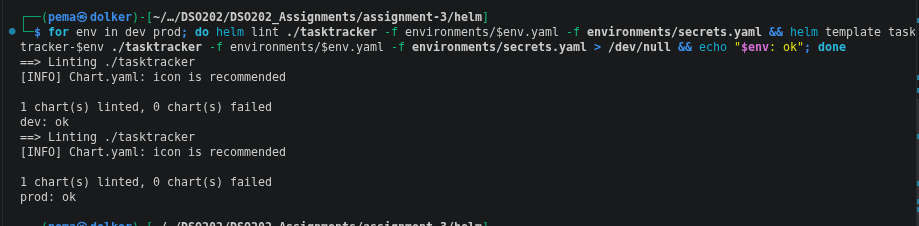

The `[INFO] icon is recommended` line is only a suggestion and does not fail the lint.

Two layers stop bad values:

- **`required`** checks that a value is present.
- **`values.schema.json`** checks types and allowed values. Some of the rules are: `environment` must be `dev` or `prod`, replica counts must be between 1 and 5, NodePorts must be between 30000 and 32767, image tags must be strings and must not be `latest` (the A1 rule), the database name must be a valid PostgreSQL name, and the PVC size must look like `1Gi`.

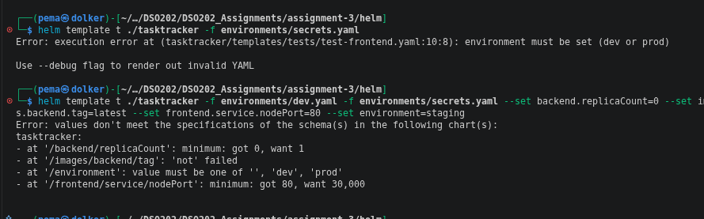

The first command (no environment file) stops with the chart's own message, `environment must be set (dev or prod)`. The second command sets four wrong values, and the schema reports all four together. The image tag rule matters more than it seems: written without quotes in a YAML file, a tag like `1.0` is read as a number and could silently become a different tag. The schema rejects it with `got number, want string`. I checked this case while writing the chart.

Neither `helm lint` nor `helm template` checks Kubernetes field names. A typo such as `replica:` instead of `replicas:` renders without any error. To catch that, the rendered chart was sent to the API server as a server-side dry run, which validates every object against the real schema without saving anything:

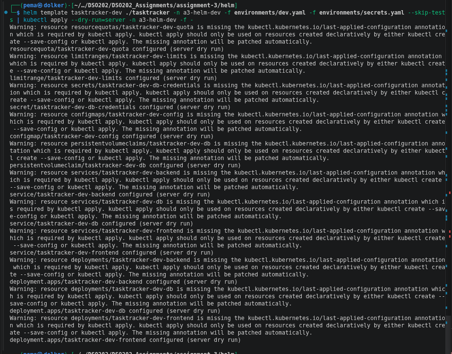

| Check | Missing required value | Wrong type or value | Unknown Kubernetes field | Needs cluster |
|---|---|---|---|---|
| `helm lint` | warning only | yes (schema) | no | no |
| `helm template` | yes | yes (schema) | no | no |
| `helm template \| kubectl apply --dry-run=server` | yes | yes (schema) | yes | yes |

### 5.7 Installing the releases

Both releases were installed with `helm upgrade --install`, which installs the release if it does not exist and upgrades it otherwise. Running the same command twice gives the same result, which is why it is the usual form in CI pipelines. `--wait` makes Helm wait until all Pods are ready before reporting success. Without it, `deployed` would only mean that the API server accepted the objects.

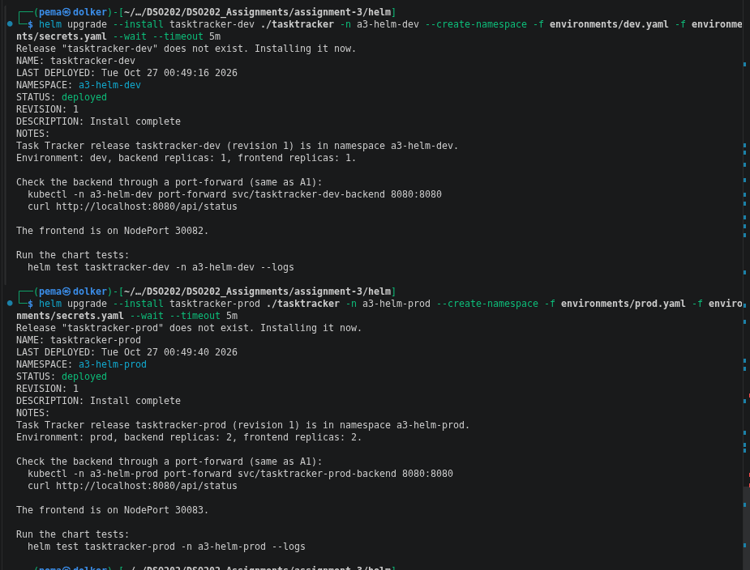

The NOTES text is rendered from `NOTES.txt` with each release's own values, so it shows the correct names, replica counts and NodePort for each environment.

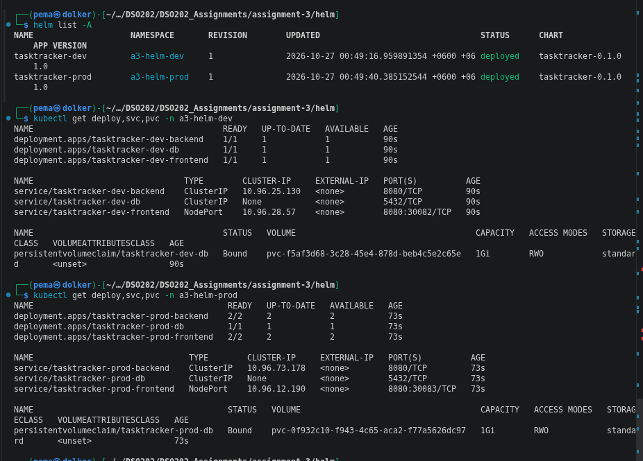

`helm list -A` shows both releases at revision 1 with status `deployed`. Prod has 2/2 backend and frontend Pods.

### 5.8 Chart tests

The chart includes two test Pods, marked with the annotation `helm.sh/hook: test`, so they are only created by `helm test` and not by install or upgrade:

- **test-backend** calls the backend's `/api/status` through its Service and passes only if the response contains `"db":"connected"`. This proves that the ConfigMap, Secret, database Service and database are all wired correctly.
- **test-frontend** downloads `config.js` from the frontend Service and passes only if `BACKEND_URL` contains this release's backend address. This proves that the frontend image rendered the ConfigMap value at start-up.

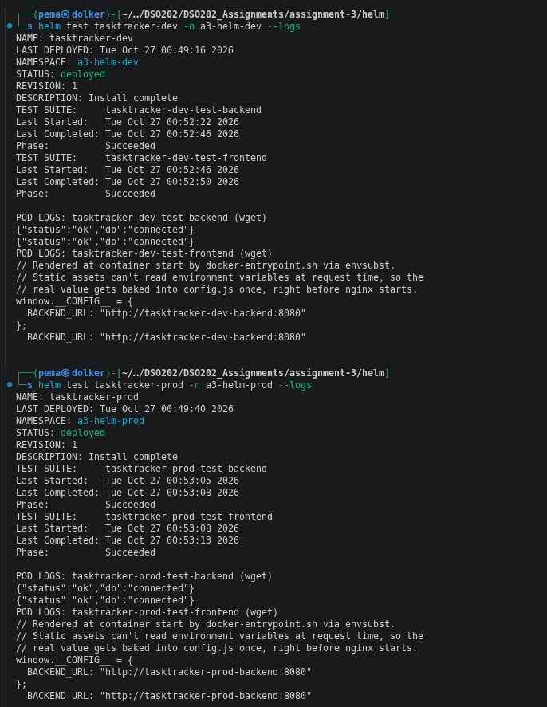

All four tests succeeded, and each frontend has its own release's backend address. Each response appears twice in the logs: the test first prints the whole response (`tee /dev/stderr`), then `grep` prints the line it matched. The second line is the actual check.

### 5.9 Upgrade and rollback

**The values-loss mistake.** The notes describe a common mistake: running `helm upgrade` with only the one `--set` that changed. When an upgrade is given any value flag, Helm starts again from the chart defaults and silently drops the values used at install time. I ran the mistake on purpose:

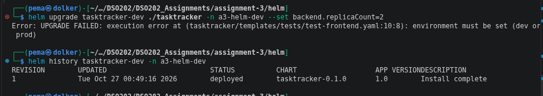

With most charts this would succeed and quietly change the release. Here it failed at rendering, because without the dev file and `secrets.yaml` the `required` values are empty. `helm history` still showed only revision 1, so nothing was sent to the cluster. The right way is to pass every values file on every upgrade.

**Correct upgrade and rollback.** The upgrade was repeated with both values files plus `--set backend.replicaCount=2`. The backend went to 2/2. Then `helm rollback tasktracker-dev 1` brought it back to 1/1:

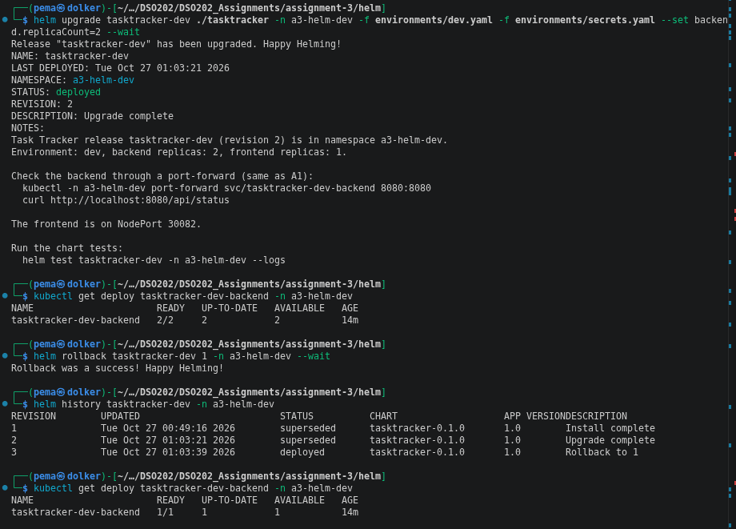

A rollback does not delete revisions or go back to number 1. It creates a new revision (3) that copies the chart and values of revision 1, so the history always shows what happened, in order. A Helm rollback also restores every object in the release together (ConfigMap, Secret, Services and Deployments), while `kubectl rollout undo` only works on one Deployment.

### 5.10 Drift and server-side apply

Helm 4 installs releases with server-side apply. With server-side apply, the API server records which client (field manager) owns each field of an object. To test this, I changed the backend's replicas to 3 directly with `kubectl patch`, outside Helm, and then ran a normal `helm upgrade`:

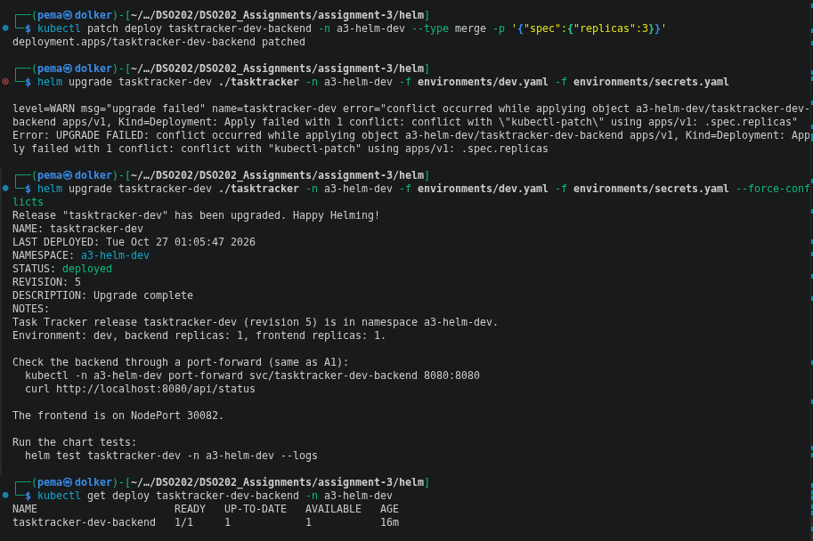

The upgrade failed with `conflict with "kubectl-patch" using apps/v1: .spec.replicas`. The `kubectl patch` command had become the owner of that field, and Helm refused to overwrite another manager's change without being told to. Running the upgrade again with `--force-conflicts` took the field back, and replicas returned to 1/1.

Helm 3 used client-side apply and would have overwritten the manual change silently. The conflict is useful because it makes drift visible. A real example is the Horizontal Pod Autoscaler, which also changes `spec.replicas`. Without the conflict, Helm and the autoscaler could keep overwriting each other without anyone noticing.

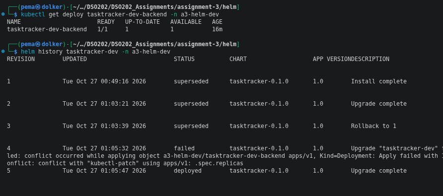

The history shows five revisions: 1 install, 2 the upgrade to 2 replicas, 3 the rollback, 4 the upgrade that failed with the conflict (recorded as `failed`), and 5 the forced upgrade, now `deployed`. Failed operations are kept in the history too.

### 5.11 The release record keeps the values

Helm stores each revision as a Secret in the release namespace, named `sh.helm.release.v1.<release>.v<revision>` and labelled `owner=helm`. This record is how `helm history`, `helm rollback` and `helm get` work without reading the live objects.

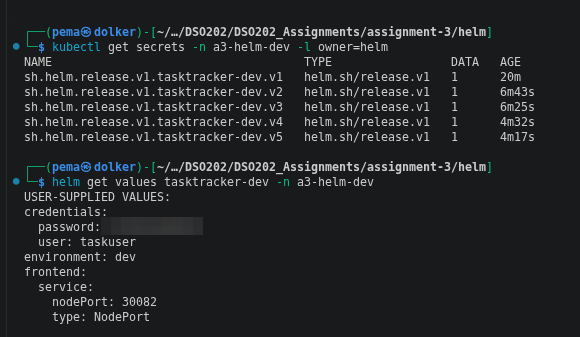

`helm get values` printed the database password in plain text (blurred in the screenshot). Everything passed to a release is stored in the release record, so anyone allowed to read Secrets in the namespace can read the values back. This is the same weakness as the base64 Secret noted in A1, but with one more copy of the password. Keeping `secrets.yaml` out of git protects the repository, but not the cluster. In a real deployment the credentials would be created outside Helm and passed in with `credentials.existingSecret`, so they would never appear in Helm's record. I did not do this here, so that the chart stays self-contained for the assignment.

### 5.12 Uninstall keeps the prod data

Before uninstalling prod, I created a task, "made before uninstall", through a port-forward to the backend.

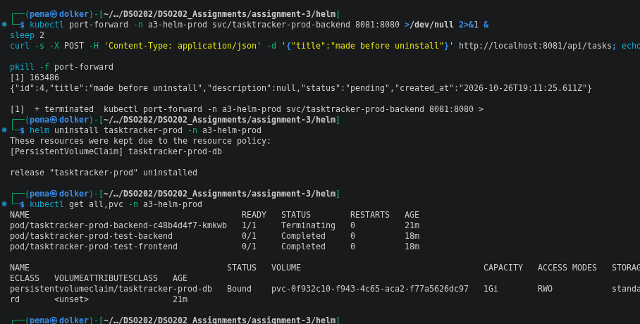

`helm uninstall tasktracker-prod` removed the Deployments, Services, ConfigMap, Secret and quota, but the PVC `tasktracker-prod-db` stayed `Bound`, because of the `helm.sh/resource-policy: keep` annotation. The two test Pods also stayed. Test Pods are hooks, not normal objects of the release, so uninstall does not remove them. They are replaced the next time `helm test` runs, because of their `before-hook-creation` delete policy.

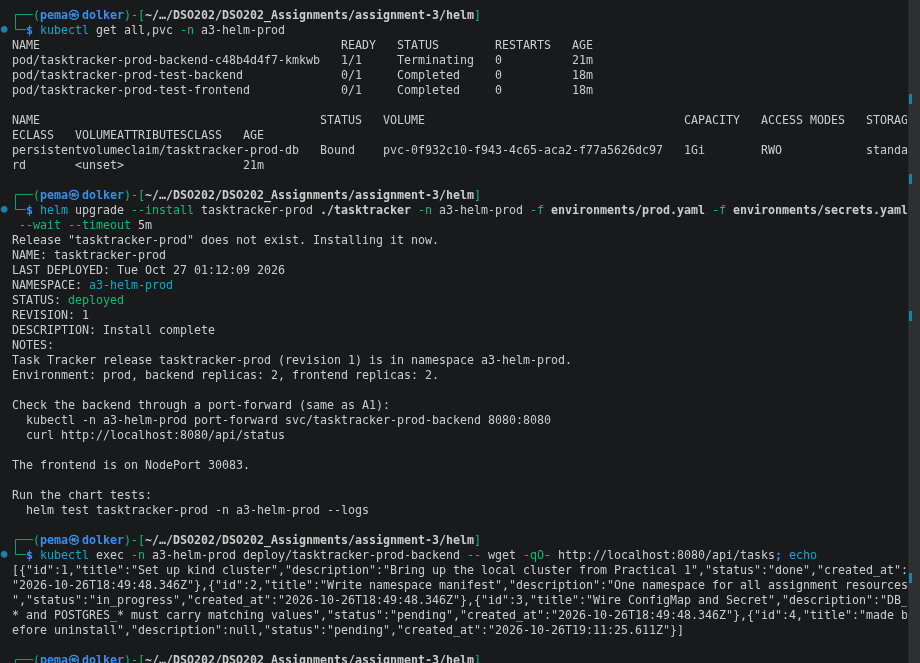

After installing prod again with the same command, task 4 was still in the list with its original `created_at` time. PostgreSQL found an existing data directory on the PVC and did not run the seed script again.

Helm adopted the kept PVC without an error. Before creating an object, Helm checks whether an object with the same name already exists, and refuses to take over one that it did not create. The kept PVC still had Helm's `managed-by` label and annotations for the same release name and namespace, so it was accepted. A PVC created by hand, or by another release, would have been refused.

Compared with section 4.6, this is the clearest difference between the two tools in this assignment. With Kustomize, deleting the overlay deleted the data. With Helm, the chart itself decides which objects must survive an uninstall.

### 5.13 Packaging and publishing the chart

Finally, the chart was packaged and pushed to my Docker Hub account as an OCI artifact:

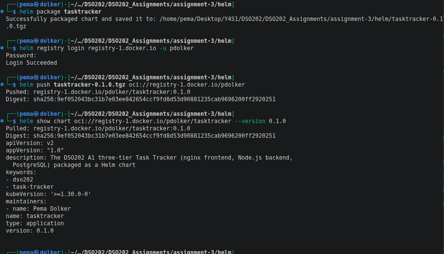

`helm package` creates `tasktracker-0.1.0.tgz`, named after the chart `version`. `helm push` uploads it to `oci://registry-1.docker.io/pdolker`, and the registry returns a SHA-256 digest that identifies exactly this content. `helm show chart` then reads it back from the registry. Docker Hub already stores the application's images, so the images and the chart now sit in the same registry with the same login. The chart could be installed by anyone with access, without cloning this repository:

```bash
helm install tasktracker-dev oci://registry-1.docker.io/pdolker/tasktracker --version 0.1.0 -f dev.yaml -f secrets.yaml
```

The `.tgz` file is in `.gitignore`, because the registry is where packaged charts belong, not the git repository.

## 6. Kustomize and Helm compared

| | Kustomize | Helm |
|---|---|---|
| Input files | Valid Kubernetes YAML | Templates that are only valid after rendering |
| How environments differ | Overlays with patches and transformers | One values file per environment |
| Extra tool needed | No, built into kubectl (`-k`) | Yes, the `helm` binary |
| Names that depend on each other | Typed by hand; `namePrefix` would break `DB_HOST` and `BACKEND_URL` (4.3) | Computed by helpers, always consistent (5.3) |
| Config change restarts Pods | Yes, generated name with hash (4.5) | Yes, checksum annotation (5.4) |
| Input validation | None of its own | `required` and a JSON schema (5.6) |
| Record of what was deployed | None; the git history is the record | Release revisions in the cluster (5.11) |
| Rollback | Revert the git commit and apply again | `helm rollback` to any revision (5.9) |
| Removal | `delete -k` removes everything, including data (4.6) | `helm uninstall`, with `resource-policy: keep` where needed (5.12) |
| Built-in tests | No | `helm test` (5.8) |
| Distribution | A directory in git | A versioned package in an OCI registry (5.13) |
| Reading the configuration | Easy: what you see is close to what is applied | Harder: templates need rendering to understand |

From working with both on the same application, I found Kustomize easier to read and quicker to start with. The base is plain YAML that anyone who knows Kubernetes can follow, and every change in an overlay is visible as a small, focused file. It fits well when a team manages its own manifests and only needs a few environment differences. Its weak points showed up when names depend on each other, and in the fact that it has no idea of a "release" once the YAML has been applied.

Helm needed more work up front (helpers, a schema, careful indentation with `nindent`), but it gave more in return: computed names, input validation, tests, a revision history with rollback, control over what an uninstall deletes, and a package that can be published and installed by someone else. It fits better when an application is shared with other people or installed many times, which is also why most third-party software is published as Helm charts.

The two tools are not exclusive. A common pattern in industry is to install a third-party Helm chart and then apply organisation-specific changes on top of it with Kustomize.

## 7. Problems I ran into

| Problem | Cause | Fix |
|---|---|---|
| `kubectl diff -k` failed with `namespaces "a3-kustomize-dev" not found` | A diff is a dry run and does not create the namespace, so every object inside it fails | Created the Namespace objects first, then ran the diff (4.4) |
| `psql -U taskuser` failed with `role "taskuser" does not exist` | `db.env` had been left with the `change-me` placeholders, so PostgreSQL was set up with the user `change-me`. The app still worked, because the backend and database got matching values | Deleted both overlays (including the PVCs), filled in the real credentials and applied again. PostgreSQL only reads `POSTGRES_USER` and `POSTGRES_PASSWORD` the first time it starts on an empty volume, so changing the Secret alone would not have changed the existing database user |
| Changing one ConfigMap value restarted all three tiers | All three Deployments refer to the same generated ConfigMap | Expected behaviour, kept to match A1 (4.5) |
| `helm upgrade` failed with a conflict on `.spec.replicas` | Field changed with `kubectl patch` outside Helm | Planned drift test; resolved with `--force-conflicts` (5.10) |
| Test Pods left after `helm uninstall` | Test Pods are hooks, not release objects | Expected; they are replaced on the next `helm test` (5.12) |
| Password in a values file is quoted | `#` starts a comment in YAML, so `TaskPass#2026` without quotes would be cut to `TaskPass` | Quoted the password in `secrets.yaml`. The Kustomize `db.env` file is not YAML, so it needs no quotes |

## 8. Limitations

- **The browser cannot reach the backend.** As in A1, the frontend's JavaScript runs in the browser and calls `BACKEND_URL`, which is a cluster-internal address. The frontend page loads on its NodePort, but the browser cannot load tasks without the A1 workaround (hosts file and port-forward). A2 solved this with an Ingress. I left the Ingress out here because the task was to reimplement Assignment 1, and all checks were done from inside the cluster or through the backend Service.
- **Secrets are only base64-encoded,** and in Helm they are also stored in the release record (5.11). The repository contains no credentials, but the cluster does.
- **No readiness or liveness probes,** to stay within the A1 design. The backend's own retry loop handles the start-up order. Without probes, `--wait` can only tell that containers are running, not that the application works, which is one reason the chart includes `helm test`.
- **A single database replica** in every environment. Prod has more backend and frontend replicas, but the database is not highly available.
- **NodePorts 30081 to 30083 are reached through the node IP,** because only 30080 is mapped to `localhost` in the kind config. On a real cluster this would be handled by an Ingress or a LoadBalancer.
- **The images are my amd64 rebuilds,** as in A1 and A2, approved by the tutor. Section 9 explains how to switch to the tutor's images on an arm64 machine, which needs one change in Kustomize and three `--set` flags in Helm.

## 9. How to reproduce

### Running on another machine

- The images are my amd64 rebuilds (see A1). On an Apple Silicon (arm64) machine, use the tutor's images instead. Nothing else changes, because both sets use the same tag, ports and environment variables:
  - **Kustomize:** add `newName: sarojsanyasi/dso202-frontend` (and the same for `-backend` and `-db`) under each entry of `images:` in `kustomize/base/kustomization.yaml`.
  - **Helm:** add `--set images.frontend.repository=sarojsanyasi/dso202-frontend --set images.backend.repository=sarojsanyasi/dso202-backend --set images.database.repository=sarojsanyasi/dso202-db` to the install command.
- A kind cluster with host port 30080 mapped (as in Practical 1) is enough. No Ingress is needed.
- Helm 4 is needed for the drift test in section 5.10. Everything else also works with Helm 3.
- The credential files are not in the repository. Create them from the `.example` files as shown below before applying anything.
- On macOS, Docker Desktop does not route to the kind node's IP, so NodePorts 30081 to 30083 cannot be reached that way. Use `kubectl port-forward` instead, for example `kubectl -n a3-kustomize-prod port-forward svc/frontend-svc 8081:8080`.

### Commands

From the `assignment-3` folder:

```bash
# credentials (gitignored)
cp kustomize/overlays/dev/db.env.example  kustomize/overlays/dev/db.env
cp kustomize/overlays/prod/db.env.example kustomize/overlays/prod/db.env
cp helm/environments/secrets.example.yaml helm/environments/secrets.yaml
# edit the three files and replace change-me

# Kustomize
kubectl apply -f kustomize/overlays/dev/namespace.yaml -f kustomize/overlays/prod/namespace.yaml
kubectl apply -k kustomize/overlays/dev
kubectl apply -k kustomize/overlays/prod

# Helm
cd helm
helm upgrade --install tasktracker-dev  ./tasktracker -n a3-helm-dev  --create-namespace -f environments/dev.yaml  -f environments/secrets.yaml --wait
helm upgrade --install tasktracker-prod ./tasktracker -n a3-helm-prod --create-namespace -f environments/prod.yaml -f environments/secrets.yaml --wait
helm test tasktracker-dev  -n a3-helm-dev  --logs
helm test tasktracker-prod -n a3-helm-prod --logs
```

To remove everything:

```bash
kubectl delete -k kustomize/overlays/dev
kubectl delete -k kustomize/overlays/prod
helm uninstall tasktracker-dev  -n a3-helm-dev
helm uninstall tasktracker-prod -n a3-helm-prod
kubectl delete pvc tasktracker-prod-db -n a3-helm-prod   # kept by resource-policy, must be deleted by hand
kubectl delete namespace a3-helm-dev a3-helm-prod
```